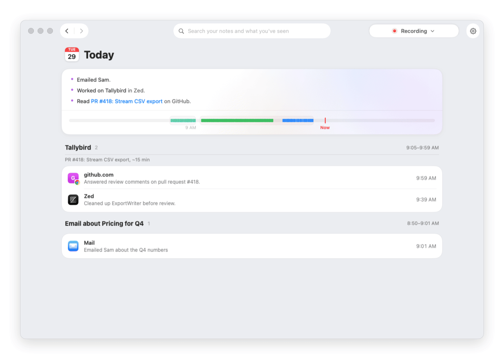

# DayDream

**Never lose your place again.**

DayDream keeps a timeline of your Mac: the apps, windows and Chrome pages you used, and what you typed. It stays on
your Mac, so you can find anything again, and AI apps you connect can check it when you ask about your own work.

<p align="center"></p>

> [!IMPORTANT]
> DayDream is beta software. Expect bugs.

- **Find your place.** Search one word. Jump to the moment, on its own day, with the window or page you had open.
- **Ask your AI.** Claude, ChatGPT, Cursor and other AI apps can answer "where did I leave off yesterday?" from your real day.
- **Get short notes.** DayDream writes short notes about your moments and days, on your Mac.
- **Keep it yours.** No account. No screenshots. Your history is stored on your Mac.

## Install

You need an Apple silicon Mac with macOS 15 or later.

1. Download DayDream from [getdaydream.app](https://getdaydream.app) or the [Releases page](https://github.com/getnorthlight/daydream/releases/latest).
2. Drag it to Applications and open it. Setup asks for two permissions and what to remember.
3. Press **Start Recording**.

Updates download quietly and install the next time DayDream quits. Step by step: [install guide](docs/install.md).

## Connect an AI app

In **Settings › Connections**, one click connects ChatGPT, Claude Desktop, Claude Code, Cursor or Windsurf. Then ask
things like "where did I leave off yesterday?" or "write my standup".

In [Lost Thread](https://github.com/getnorthlight/lost-thread), an open benchmark of questions about three made-up work
weeks, Claude's helpful answers went from 3.7% to 66.7% with DayDream.

## What it records

| Recorded | Never recorded |
| --- | --- |
| The app in front, its window title, and when | Screenshots, the screen, audio or the camera |
| That you clicked (not where, or on what) | Password fields, or anything while macOS secure input is on |
| Page titles and sites in Google Chrome | Incognito and Guest windows, Safari and the other browsers DayDream knows |
| What you type in the apps and sites you allow | Common password managers, and any app or site you exclude |

Typing and Chrome pages start on in setup, and one click turns either off. The full list, app by app:
[what DayDream records](docs/README-details.md#what-daydream-records).

## How it works

DayDream is a native Swift app. Everything it records goes into one folder on your Mac,
`~/Library/Application Support/DayDream/`, which only your macOS account can open.

### Recording

| macOS permission | What DayDream uses it for |
| --- | --- |
| Accessibility | The app in front and its window title. It also checks that a text field is safe before any typing is saved. |
| Input Monitoring | Clicks, and what you type while typing is on. Password fields are skipped. DayDream only listens: it can't change or block a key or a click. |
| Automation: Google Chrome (optional) | Apple Events ask Chrome for the front tab's title and address, and whether any window is Incognito. No scripts run inside Chrome. |

DayDream doesn't use Screen Recording, the microphone or the camera. It reads nothing from Chrome until it has
checked that the Chrome in front is signed by Google, and nothing at all while an Incognito or Guest window is open.

### Storage and search

- **History** is a SQLite database, `memory.sqlite`, in DayDream's folder.
- **Typed words** are encrypted with AES-GCM, with a 256-bit key for each day kept in your macOS Keychain. The exact
  words are deleted after 7 days unless you choose another time.
- **Search** runs on a bundled copy of [Typesense](https://github.com/typesense/typesense) 30.2, the unmodified
  official build. It listens on `127.0.0.1` only, with search and access logging off. Typed words never go into its
  index: DayDream searches them itself, on your Mac. If the index isn't ready, search reads SQLite directly.

### AI apps (MCP)

The AI app starts `mac-mem mcp` and talks to it over standard input and output. The server opens no network port and
connects to nothing outside your Mac: it only asks DayDream's own search server on `127.0.0.1`. It has four read-only
tools:

| Tool | What it returns |
| --- | --- |
| `timeline` | What you did in a period, like today or this week, ending with where you left off |
| `search` | One thing across your history: a doc, site, person or project |
| `details` | One item in full: its visits, its notes, and the words you typed in it if you allow that |
| `status` | Whether DayDream is set up and recording, and whether this connection works |

The tools can't start or stop recording, change settings, delete or send anything. Typed words reach an AI app only
while **Let AI apps see your typed words** is on and DayDream is open. The DayDream app hands them over through a
private local socket after it checks that AI app's key. **Disconnect** removes DayDream's entry from the AI app and
turns its key off. What an AI app reads goes to its AI provider as part of that chat.

### Summaries

- **On this Mac** (the default where it can run): [llama.cpp](https://github.com/ggml-org/llama.cpp) libraries inside
  the app run [Qwen3.5-4B](https://huggingface.co/Qwen/Qwen3.5-4B) (Q4_K_M, 2.74 GB) in the DayDream process. There is
  no server or port. The model is downloaded once from Hugging Face and checked against its size and SHA-256 before
  it's used. It needs 8 GB of memory.
- **Cloud** (off until you add your own [OpenRouter](https://openrouter.ai) key): each request asks for a model host
  that keeps no data, with no fallback to other hosts. Only activity recorded after you turn it on is sent. The key is
  kept in your Keychain.

How notes are written and checked: [docs/summaries.md](docs/summaries.md).

### Updates and signing

The app is signed with DayDream's Apple Developer ID and notarized by Apple. Updates come through
[Sparkle](https://sparkle-project.org) and are signed with an EdDSA key. DayDream checks once a day and refuses an
update whose signature doesn't match. You can turn automatic updates off in Settings › Advanced › App
updates.

### Anonymous usage counts

About once an hour, DayDream sends a few counts to PostHog (`us.i.posthog.com`) with a random ID made for your copy:
that it was installed, setup steps finished, a daily check of which features are on and about how long it recorded,
how many summaries were written or failed, how often AI apps use each tool,
how often you open and search DayDream, and the version after an update. Never your history, typed words, titles,
sites or searches. Turn them off with **Share anonymous usage counts** in Settings › Advanced, where **See what's
sent** shows the last counts exactly as they go. [The full list](docs/README-details.md#usage-counts).

### Your data

- History is kept until you delete it. **Forget This Moment…** deletes a moment, and excluding an app hides what it
  recorded.
- **Uninstall DayDream…** in Settings › Advanced removes the app, with or without your history
  ([uninstall guide](docs/uninstall.md)).
- **Backup and restore** in Settings › Advanced saves your history to a folder you choose
  ([backups](docs/backup-restore.md)).
- For full-disk encryption, turn on FileVault.

Every network connection DayDream makes is listed in [Network connections](docs/README-details.md#network-connections).
[Privacy policy](PRIVACY.md) · [Security details](SECURITY.md) · [FAQ](docs/faq.md)

## Build from source

You need an Apple silicon Mac with Xcode or the Xcode Command Line Tools.

```sh
git clone https://github.com/getnorthlight/daydream.git
cd daydream
scripts/bootstrap.sh   # fetches Sparkle 2.9.6 and checks its SHA-256
swift build
```

| Product | What it is |
| --- | --- |
| `MacMem` | The app: menu bar, windows, recorder and summaries |
| `mac-mem` | The command-line tool and MCP server. It also starts and watches the search server |
| `mac-mem-backup` | The backup and restore helper |
| `typesense-server` | Not built here: the release app carries the official Typesense build, and its GPL source kit is attached to every release |

Try the command-line tool on made-up data:

```sh
demo="$(mktemp -d)/daydream-demo"
.build/debug/mac-mem --home "$demo" demo
.build/debug/mac-mem --home "$demo" --local search SQLite
```

Release flags, project layout and checks: [Build from source](docs/README-details.md#build-from-source),
[project layout](docs/README-details.md#project-layout) and [CONTRIBUTING.md](CONTRIBUTING.md).

## Feedback

Choose **Report a Problem…** in DayDream's menu. It opens an email for you to read and send, with app details and no
history. Please don't paste your history into a public issue.

## License

[MIT](LICENSE). The DayDream name and icon aren't covered; see [TRADEMARKS.md](TRADEMARKS.md). DayDream builds on
[open-codex-computer-history](https://github.com/hqhq1025/open-codex-computer-history), Sparkle, llama.cpp, Qwen and
Typesense (GPL-3.0); see [credits](docs/README-details.md#license-trademarks-and-credits).
